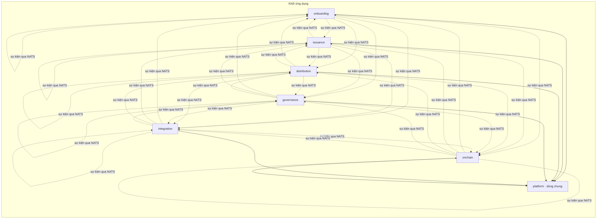
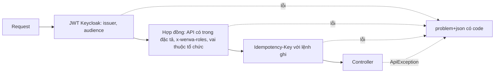
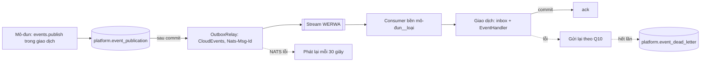
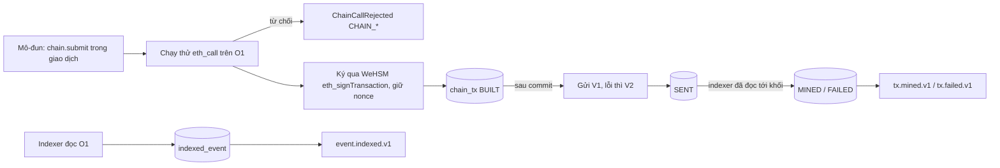
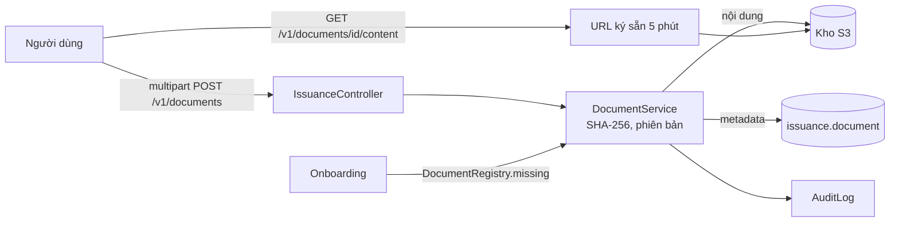
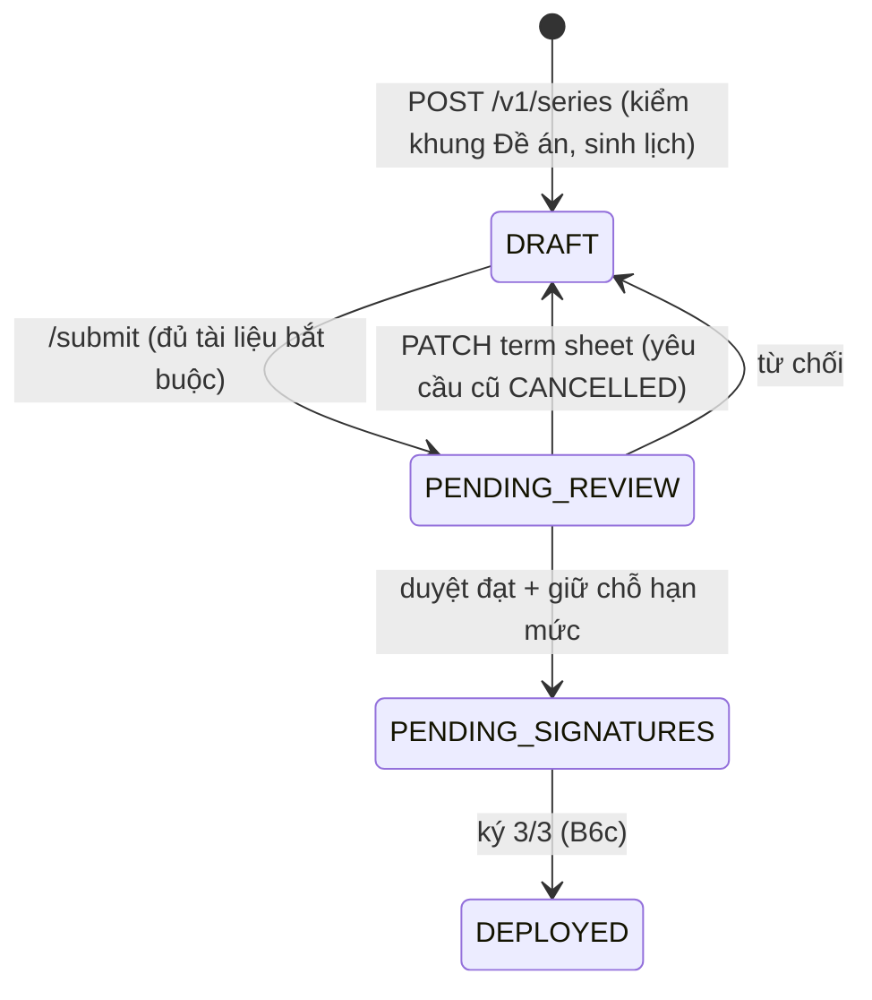
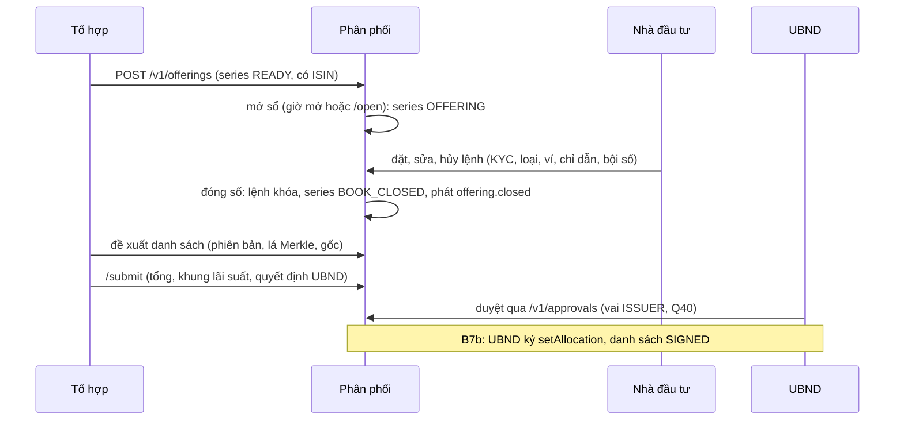
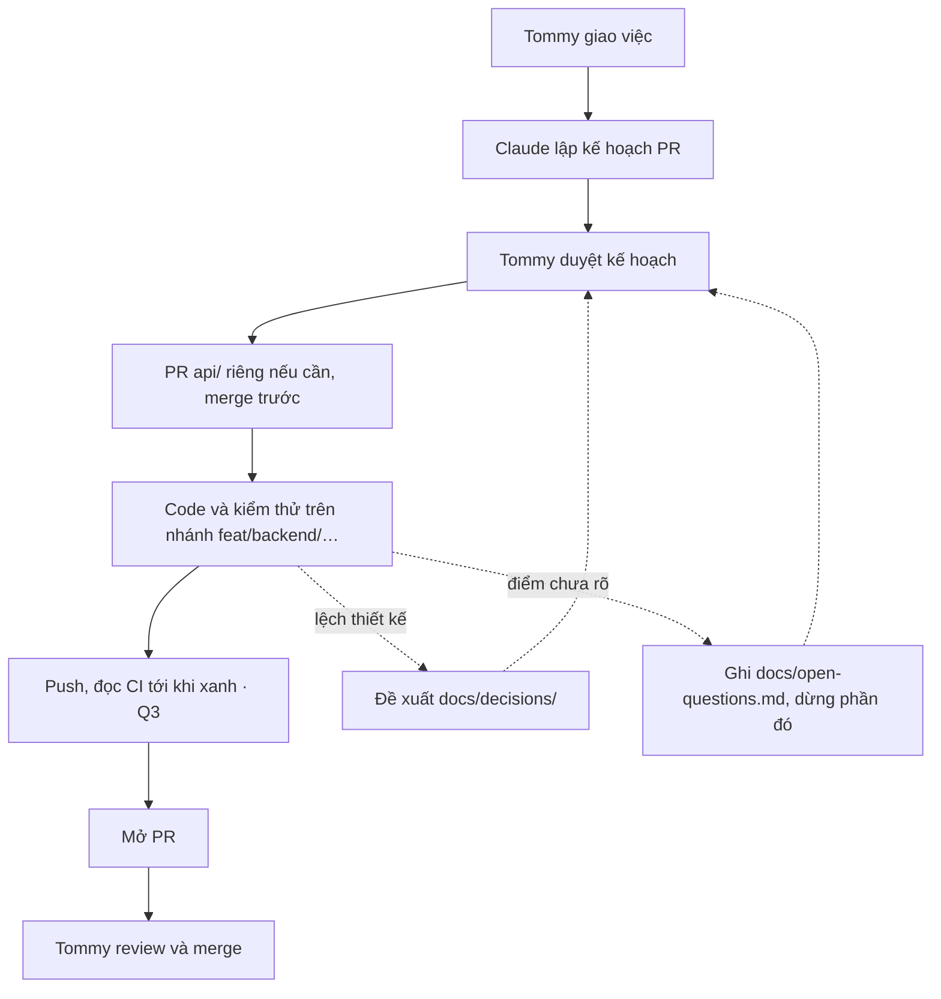

# backend/ — ứng dụng WeRWA

Một khối triển khai (ADR-10), Java 21, Spring Boot 4.1, Spring Modulith 2.1, PostgreSQL, Flyway. Quyết định riêng của luồng backend: D1–D9, Q1–Q3 trong `docs/open-questions.md`.

## Mô-đun



| Gói | Mô-đun | Schema |
|---|---|---|
| `vn.werwa.onboarding` | Onboarding · phân hệ 1 | `onboarding` |
| `vn.werwa.issuance` | Phát hành · phân hệ 2 | `issuance` |
| `vn.werwa.distribution` | Phân phối · phân hệ 3 | `distribution` |
| `vn.werwa.governance` | Quản trị · phân hệ 4 | `governance` |
| `vn.werwa.integration` | Tích hợp · phân hệ 5 | `integration` |
| `vn.werwa.onchain` | Onchain · phân hệ 6 | `onchain` |
| `vn.werwa.platform` | Dùng chung, không nghiệp vụ (D3) | `platform`, chỉ bảng kỹ thuật (Q1) |

- Mô-đun phân hệ chỉ gọi nhau qua gói `api` (named interface); còn lại đi bằng sự kiện, kể cả trong cùng khối (D4).
- `platform` là mô-đun mở: mọi mô-đun dùng được, nhưng `platform` không phụ thuộc mô-đun phân hệ nào.
- Mỗi mô-đun chỉ đọc ghi schema của mình. Migration ở `src/main/resources/db/migration`, đặt tên `V<n>__<mô-đun>_<việc>.sql`.
- `ModularityTests` chạy `ApplicationModules.verify()`; vi phạm ranh giới thì build đỏ. Tài liệu mô-đun sinh ở `target/spring-modulith-docs` (CI đính kèm).

## Chạy trên máy

Cần JDK 21, Maven 3.9+, Docker (cho kiểm thử tích hợp). Dựng devnet rồi nạp tệp env gộp (I11):

```bash
infra/werwa.sh up --signer wehsm            # hoặc không có --signer: chưa mint, cấp claim được
set -a; source "$(infra/werwa.sh env)"; set +a
cd backend && mvn spring-boot:run
```

| Lệnh | Việc |
|---|---|
| `mvn test` | Kiểm thử đơn vị và `ApplicationModules.verify()` |
| `mvn verify` | Thêm kiểm thử tích hợp `*IT` (Testcontainers: PostgreSQL 18.6, NATS 2.15.1, S3Mock; Besu cho kiểm thử chuỗi) |

## Cấu hình

`WerwaProperties` (`werwa.*`) bind đúng tên biến của `infra/werwa.sh env` theo I11, I13 và kiểm khi khởi động:

- `werwa.chain.read-urls` không được trùng `submit-urls`: ứng dụng chỉ đọc qua O1 (ADR-12).
- `signing-mode=pkcs11` thì bắt buộc `werwa.signer.url`, `werwa.signer.token`.
- Hợp đồng và Safe tra bằng `contract("seriesFactory")`, `safe("governance3of3")`: biến môi trường làm mất chữ hoa, nên không đọc map trực tiếp.

## Nền API (B1)

Mọi API `/v1/**` đi qua chuỗi kiểm dưới đây trước khi tới controller. Controller của mô-đun cài interface sinh từ `api/openapi.yaml` (gói `vn.werwa.platform.openapi.api`, D6), không tự khai đường dẫn.



| Cần | Dùng |
|---|---|
| Lỗi nghiệp vụ | Enum mã lỗi của mô-đun cài `ErrorCode`, ném `ApiException` |
| Người gọi | `CurrentUser.get()`: `subject`, `organizationId`, `roles` |
| Đối tượng thuộc tổ chức khác (US-4.07-AC2) | `OrgScope.requireOwnOrganization(owner)` hoặc `requireOwnOrganizationOr(owner, vai xem chéo)` |
| Ghi đè | Cột `version`; trả `ETag: ETags.of(version)`; kiểm `ETags.requireMatch(ifMatch, version)` |
| Khóa chính | `Ids.newId()` (UUIDv7) |
| Tiền, tỷ lệ | `Money` (`amountMinor` nguyên), `Ppm`; `Ppm.applyExact` theo quy tắc C5 |
| Phân trang | `Paging.limit(limit)`, `Paging.decodeCursor`, `Paging.Page.of(rows, limit, idOf)` |
| Kiểm response khớp đặc tả trong test | `OpenApiSchemas.validate("<Schema>", json)` |

`Idempotency-Key` theo người dùng (Q6), giữ 24 giờ ở `platform.idempotency_key`; trả lại kèm `Idempotent-Replayed: true`; kết quả 5xx không lưu. Webhook ngân hàng (`/v1/inbound/**`, mTLS) đóng tới B8. Vai tổ chức đọc từ tệp seed devnet tới B5 (Q5).

## Sự kiện giữa mô-đun (B2)

Mọi sự kiện giữa mô-đun đi qua NATS JetStream, kể cả trong cùng khối (D4). Không dùng `@ApplicationModuleListener` hay `@EventListener` giữa các mô-đun.



| Cần | Dùng |
|---|---|
| Phát sự kiện | `events.publish(type, subject, data)` trong giao dịch; `type` phải có trong `api/events/catalog.yaml` và thuộc mô-đun phát |
| Nhận sự kiện | Bean cài `EventHandler`: `consumer()` là tên mô-đun, `eventType()`, `handle(InboundEvent)`; đọc dữ liệu bằng `event.data(Kiểu.class)` |
| Kiểm sự kiện khớp lược đồ trong test | `EventSchemas.validate(type, cloudEventBytes)` |
| Kiểm thử tích hợp | Kế thừa `IntegrationTest`: PostgreSQL và NATS thật, stream tạo từ tệp của infra |

Consumer mới đọc từ đầu stream (giữ 30 ngày); inbox chặn xử lý trùng. Thêm bên nhận cho loại sự kiện đã có thì bên đó sẽ nhận cả sự kiện cũ còn trong stream.

## Onchain (B3)



| Cần | Dùng |
|---|---|
| Mã hóa calldata | `calls.load(AuditAnchor.class, calls.address("auditAnchor")).anchor(...).encodeFunctionCall()`; lớp hợp đồng sinh từ `api/abi` vào `vn.werwa.onchain.api.contracts` |
| Gửi giao dịch khóa vận hành Holco | `chain.submit(new TxRequest(purpose, subjectRef, SignerKey.HOLCO_OPERATOR, to, data))` trong giao dịch DB; kết quả qua `werwa.onchain.tx.mined.v1` / `tx.failed.v1` |
| Đọc sự kiện chuỗi | Nhận `werwa.onchain.event.indexed.v1`, đọc chi tiết ở `onchain.indexed_event` qua API của Onchain |
| Kiểm thử có chuỗi | Kế thừa `ChainIntegrationTest`: Besu QBFT một node, `DeployPlatform` thật, ký bằng khóa thử (Q15). Cần Foundry 1.8.5 và `jq` trên máy |

Chế độ ký `devnet` (I12) không ký được: gửi giao dịch trả 503 `CHAIN_SIGNER_UNAVAILABLE`. Chế độ `pkcs11` ký qua WeHSM bằng `eth_signTransaction` (Q14), chờ phiên WeHSM bổ sung.

## Quản trị (B4a)

| Cần | Dùng |
|---|---|
| Duyệt 4 mắt | `approvals.request(actionType, subjectRef, payload)` trong giao dịch; chờ `werwa.governance.approval.decided.v1`. Nội dung đổi thì gọi lại: yêu cầu cũ chuyển `CANCELLED` (Q19) |
| Nhật ký thao tác trọng yếu | `auditLog.record(action, subjectRef, payload)` trong giao dịch; chỉ lưu SHA-256 của nội dung. Lệnh ghi API thành công đã được ghi tự động (Q22) |
| Kiểm chuỗi nhật ký | `auditVerification.verify()`: tính lại mã băm và so với neo trên chuỗi |
| API chưa làm | Không cần viết gì: phương thức mặc định trả 501 `NOT_IMPLEMENTED` (Q20) |

Người duyệt cùng tổ chức, khác người lập (Q18). Nhật ký chỉ ghi thêm (trigger chặn sửa, xóa); neo lên `AuditAnchor` lúc 00:15 giờ Việt Nam cho ngày trước, tự bù 7 ngày gần nhất (Q21). Người dùng ghi theo subject OIDC tới khi có bảng `app_user` (B5).

## Onboarding (B5a)

| Cần | Dùng |
|---|---|
| Tổ chức đã qua KYB và vai của nó | Bảng `onboarding.organization`; kiểm quyền đọc từ đây (Q5). Tổ chức chưa qua KYB thì người dùng của nó bị 403 `ORGANIZATION_UNKNOWN` |
| Người ký còn hiệu lực (B4b) | `onboarding.api.Signers.active(address, ngày)` |
| Sàng lọc KYC | `integration.api.Screening.screen(...)`; XD dùng bộ giả lập: tên chứa `SANCTIONED` thì trùng cấm vận, chứa `PEP` thì trùng PEP |
| Danh mục loại nhà đầu tư | `onboarding.investor_class` (Q25) |

KYB duyệt 4 mắt qua `Approvals` (B4a); quyết định qua `/kyb-decision` hay `/v1/approvals/{id}/decision` đều áp vào tổ chức. Ở devnet, đặt `WERWA_ONBOARDING_SEEDORGANIZATIONS=classpath:seed/orgs.json` để nạp 12 tổ chức thử (I6); môi trường thật để trống.

## Tài liệu (B6a)



| Cần | Dùng |
|---|---|
| Lưu tài liệu | `POST /v1/documents` (multipart, tối đa 50 MB). Mỗi lần tải là bản ghi mới; `supersedesId` trỏ bản trước, một bản chỉ có một bản kế tiếp (409 `DOCUMENT_ALREADY_SUPERSEDED`) |
| Xem, tải | `GET /v1/documents/{id}`, `GET /v1/documents/{id}/content` trả URL ký sẵn kèm `sha256` để bên tải tự kiểm (Q29) |
| Ai thấy gì | `INTERNAL`: mọi vai trừ `INVESTOR`, `CUSTODIAN`; người không được xem nhận 404 (US-2.04-AC3). `INVESTOR`, `PUBLIC`: mọi vai |
| Mô-đun khác kiểm mã tài liệu | `platform.documents.DocumentRegistry.missing(ids)`; Onboarding trả 422 `DOCUMENT_NOT_FOUND` (Q26) |
| Cấu hình | `werwa.storage.endpoint`, `bucket`, `access-key`, `secret-key`, `path-style`, `download-ttl`. Bucket do infra tạo; ứng dụng dừng khi khởi động nếu không có bucket (Q30) |

## Phát hành (B6b)



| Cần | Dùng |
|---|---|
| Kiểm nghiệp vụ lúc duyệt | Bean `governance.api.ApprovalHook` theo loại thao tác; chạy trong giao dịch duyệt, ném lỗi thì yêu cầu vẫn PENDING (Q28). Đang có: `ORGANIZATION_KYB`, `PROGRAM_ACTIVATE`, `SERIES_SUBMIT` |
| Đề án | `POST /v1/programs` gửi duyệt; duyệt đạt thì EFFECTIVE. Điều chỉnh bằng bản mới có `amendsProgramId`; bản cũ SUPERSEDED |
| Hạn mức | `issuance.limit_ledger_entry` chỉ ghi thêm; tính trên cả chuỗi Đề án theo khối lượng bản hiệu lực (Q37). RELEASE ở B6c (hủy), USE ở B8 (mint) |
| Lịch ngày làm việc | `governance.api.BusinessCalendar`; luật VN (cả âm lịch), NY cộng bảng `governance.holiday_calendar` (Q32). Sửa bảng và tính lại lịch các series: B12 |
| Lịch sự kiện | Sinh khi tạo, sửa series; quy tắc dời ngày `werwa.issuance.business-day-convention` (FOLLOWING, MODIFIED_FOLLOWING) |
| Tài liệu bắt buộc | `werwa.issuance.required-document-types` (Q31), kiểm khi gửi duyệt trên `termsDocumentId` + `documentIds` (Q38) |
| `termsHash` | SHA-256 của JSON chuẩn hóa gồm tham số series và SHA-256 các tài liệu (Q34) |
| Mã băm tiện ích | `platform.hash.Hashes` (chuyển từ governance để mọi mô-đun dùng) |

## Phân phối (B7a)



| Cần | Dùng |
|---|---|
| Lá, gốc, đường chứng minh | `distribution.allocation.AllocationMerkle`, khớp `SeriesLeaves` và `MerkleProof` của OpenZeppelin; UUID sang `bytes32` theo Q43 |
| `listHash` | SHA-256 của JSON chuẩn hóa (Q44), đi kèm yêu cầu duyệt và sau này là đối số `setAllocation` |
| Duyệt khác tổ chức | `Approvals.request(..., Role.ISSUER)` (Q40); hàng chờ `/v1/approvals` gồm yêu cầu chỉ định vai của người xem |
| Ví, điều kiện nhà đầu tư | `onboarding.api.Wallets`, `onboarding.api.Investors` (Q41); ví nạp từ B5b |
| Series từ Phân phối | `issuance.api.SeriesCatalog` (tham số, `markOffering`, `markBookClosed`), `issuance.api.IssuerDecisions` |
| Tham số | `werwa.distribution.order-quantity-step` (Q42), `book-scheduler-enabled`, `book-schedule-interval` (Q46) |
| Kiểm thử lớp nền | Hợp đồng thăm dò `src/test/resources/probe/openapi-probe.yaml` nạp qua `werwa.api.probe-contract`, để `ContractProbeController` không đụng đường dẫn thật |

## Báo có và theo dõi tiền (B8a)

```mermaid
sequenceDiagram
  participant B as BIDV (giả lập)
  participant I as Tích hợp
  participant D as Phân phối
  B->>I: webhook báo có (mTLS ở ingress, X-Bank-Signature)
  I->>I: kiểm chữ ký, chặn trùng theo bankRef, lưu nguyên văn
  I-->>D: credit_received
  D->>D: đối chiếu theo tài khoản ảo: MATCHED, SHORT, OVER, UNKNOWN
  D-->>D: payment.matched; định kỳ: quá hạn, gom lô (gốc Merkle)
  Note over D: B8b: BIDV ký gốc lô, mint
```

| Cần | Dùng |
|---|---|
| Kênh webhook ngân hàng | `platform.inbound.BankChannel`; Tích hợp cài `BidvBankChannel` khi có `werwa.integration.bidv.public-key` (Q49). Không có thì 403, sai chữ ký thì 401 và ghi `integration.inbound_message` |
| Tài khoản ảo | `integration.api.VirtualAccounts` (Q51); mở khi UBND duyệt danh sách; giả lập `werwa.integration.bidv.virtual-account-prefix` + 10 chữ số |
| Đối chiếu, quá hạn, lô | `distribution.payment.PaymentService` (Q52–Q54); việc định kỳ `werwa.distribution.payment-batch-interval` (mặc định PT15M), ân hạn `payment-grace-business-days` |
| Tiến độ ghi sổ | `GET /v1/series/{id}/issuance-progress` |
| Giả lập BIDV | `bidv-simulator/` (Q55), mô-đun Maven riêng; xem README trong đó |

## Quy trình làm việc



## Lộ trình nhóm PR

| Thời gian | Nhóm | Nội dung | Cảnh demo |
|---|---|---|---|
| Chuẩn bị | B0 | Khung dự án, 7 mô-đun, Flyway, cấu hình, CI | |
| | B1 | Nền API: problem+json, Idempotency-Key, If-Match, UUIDv7, tiền và ppm, JWT `org_id`/`roles`, maker ≠ checker, sinh interface từ OpenAPI | |
| | B2 | Outbox → NATS JetStream, CloudEvents, inbox chống trùng | |
| Sprint 1 | B3 | Onchain: web3j từ ABI, `chain_tx`, gửi qua V1/V2, đọc O1, ký qua WeHSM, indexer | ⑩ |
| | B4 | Quản trị: duyệt 4 mắt, đề nghị ký EIP-712, Safe EIP-1271, nhật ký nối mã băm, neo hằng ngày | xuyên suốt |
| Sprint 2 | B5 | Onboarding: KYB, KYC, phân loại, ví, claim | ② ③ |
| | B6 | Phát hành: Đề án, hạn mức, tài liệu, series, quyết định UBND, ISIN | ① |
| Sprint 3 | B7 | Đợt chào bán, sổ lệnh, danh sách phân bổ, Merkle | ④ |
| | B8 | Giả lập BIDV, bộ điều phối ghi sổ, mint | ⑤ ⑥ |
| Sprint 4 | B9 | Sổ người sở hữu, sao kê, chuyển OTC | ⑦ |
| | B10 | Phong tỏa, chuyển cưỡng chế | ⑨ |
| Sprint 5 | B11 | Coupon, danh sách chốt, đối soát | ⑧ |
| | B12 | Giám sát, tham số, lịch ngày nghỉ, webhook cảnh báo (I5) | xuyên suốt |
| | B13 | Đáo hạn, hoàn gốc | ⑪ |
