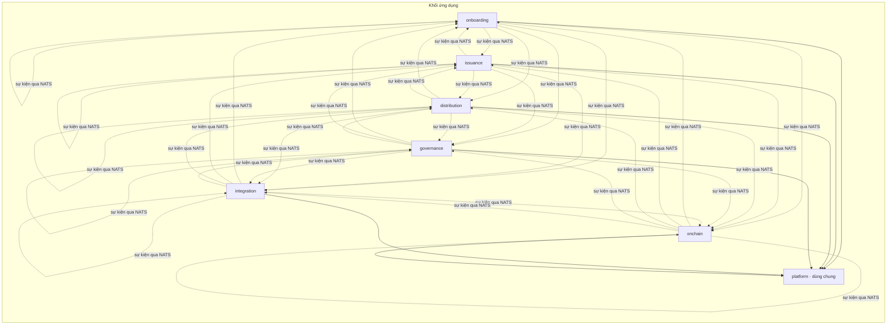
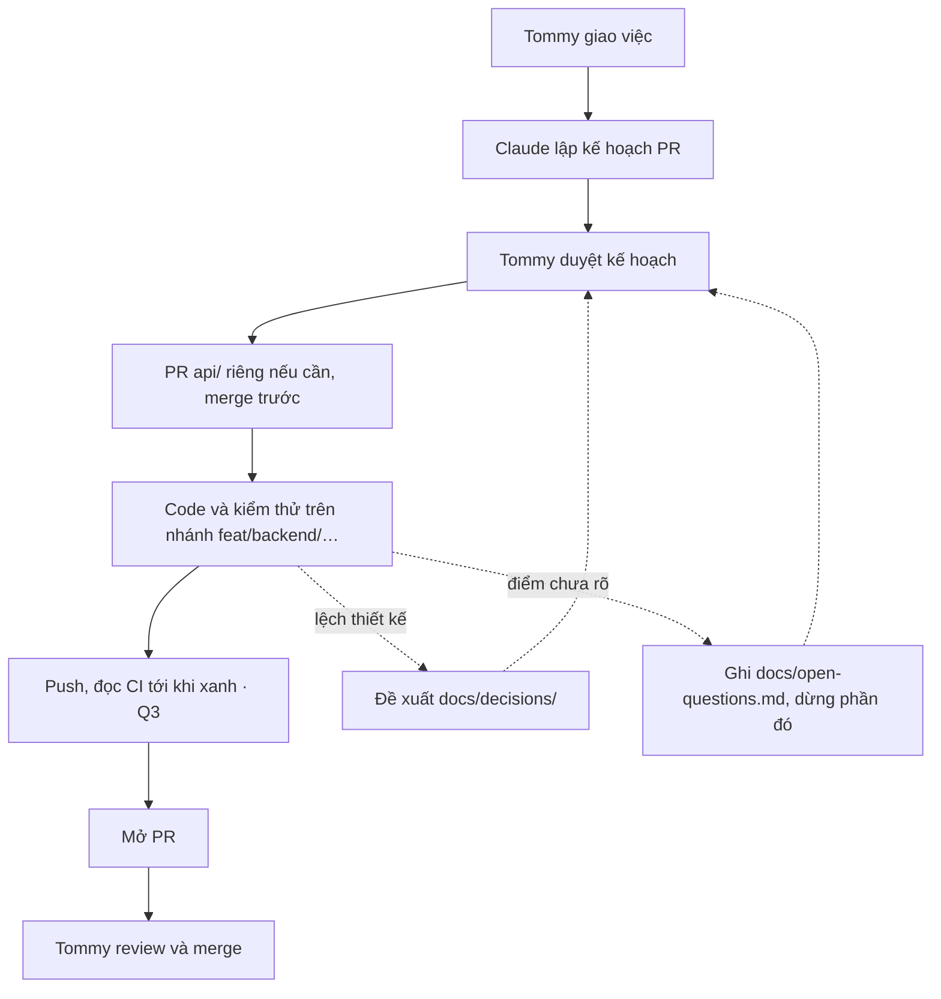

# backend/ — ứng dụng WeRWA

Một khối triển khai (ADR-10), Java 21, Spring Boot 4.0, Spring Modulith 2.0, PostgreSQL, Flyway. Quyết định riêng của luồng backend: D1–D9, Q1–Q3 trong `docs/open-questions.md`.

## Mô-đun



| Gói | Mô-đun | Schema |
|---|---|---|
| `vn.werwa.onboarding` | Onboarding · phân hệ 1 | `onboarding` |
| `vn.werwa.issuance` | Phát hành · phân hệ 2 | `issuance` |
| `vn.werwa.distribution` | Phân phối · phân hệ 3 | `distribution` |
| `vn.werwa.governance` | Quản trị · phân hệ 4 | `governance` |
| `vn.werwa.integration` | Tích hợp · phân hệ 5 | `integration` |
| `vn.werwa.onchain` | Onchain · phân hệ 6 | `onchain` |
| `vn.werwa.platform` | Dùng chung, không nghiệp vụ (D3) | `platform`, chỉ bảng kỹ thuật (Q1) |

- Mô-đun phân hệ chỉ gọi nhau qua gói `api` (named interface); còn lại đi bằng sự kiện, kể cả trong cùng khối (D4).
- `platform` là mô-đun mở: mọi mô-đun dùng được, nhưng `platform` không phụ thuộc mô-đun phân hệ nào.
- Mỗi mô-đun chỉ đọc ghi schema của mình. Migration ở `src/main/resources/db/migration`, đặt tên `V<n>__<mô-đun>_<việc>.sql`.
- `ModularityTests` chạy `ApplicationModules.verify()`; vi phạm ranh giới thì build đỏ. Tài liệu mô-đun sinh ở `target/spring-modulith-docs` (CI đính kèm).

## Chạy trên máy

Cần JDK 21, Maven 3.9+, Docker (cho kiểm thử tích hợp). Dựng devnet rồi nạp tệp env gộp (I11):

```bash
infra/werwa.sh up --signer wehsm            # hoặc không có --signer: chưa mint, cấp claim được
set -a; source "$(infra/werwa.sh env)"; set +a
cd backend && mvn spring-boot:run
```

| Lệnh | Việc |
|---|---|
| `mvn test` | Kiểm thử đơn vị và `ApplicationModules.verify()` |
| `mvn verify` | Thêm kiểm thử tích hợp `*IT` (Testcontainers: PostgreSQL 18.6; Besu, NATS từ nhóm B2, B3) |

## Cấu hình

`WerwaProperties` (`werwa.*`) bind đúng tên biến của `infra/werwa.sh env` theo I11, I13 và kiểm khi khởi động:

- `werwa.chain.read-urls` không được trùng `submit-urls`: ứng dụng chỉ đọc qua O1 (ADR-12).
- `signing-mode=pkcs11` thì bắt buộc `werwa.signer.url`, `werwa.signer.token`.
- Hợp đồng và Safe tra bằng `contract("seriesFactory")`, `safe("governance3of3")`: biến môi trường làm mất chữ hoa, nên không đọc map trực tiếp.

## Quy trình làm việc



## Lộ trình nhóm PR

| Thời gian | Nhóm | Nội dung | Cảnh demo |
|---|---|---|---|
| Chuẩn bị | B0 | Khung dự án, 7 mô-đun, Flyway, cấu hình, CI | |
| | B1 | Nền API: problem+json, Idempotency-Key, If-Match, UUIDv7, tiền và ppm, JWT `org_id`/`roles`, maker ≠ checker, sinh interface từ OpenAPI | |
| | B2 | Outbox → NATS JetStream, CloudEvents, inbox chống trùng | |
| Sprint 1 | B3 | Onchain: web3j từ ABI, `chain_tx`, gửi qua V1/V2, đọc O1, ký qua WeHSM, indexer | ⑩ |
| | B4 | Quản trị: duyệt 4 mắt, đề nghị ký EIP-712, Safe EIP-1271, nhật ký nối mã băm, neo hằng ngày | xuyên suốt |
| Sprint 2 | B5 | Onboarding: KYB, KYC, phân loại, ví, claim | ② ③ |
| | B6 | Phát hành: Đề án, hạn mức, tài liệu, series, quyết định UBND, ISIN | ① |
| Sprint 3 | B7 | Đợt chào bán, sổ lệnh, danh sách phân bổ, Merkle | ④ |
| | B8 | Giả lập BIDV, bộ điều phối ghi sổ, mint | ⑤ ⑥ |
| Sprint 4 | B9 | Sổ người sở hữu, sao kê, chuyển OTC | ⑦ |
| | B10 | Phong tỏa, chuyển cưỡng chế | ⑨ |
| Sprint 5 | B11 | Coupon, danh sách chốt, đối soát | ⑧ |
| | B12 | Giám sát, tham số, lịch ngày nghỉ, webhook cảnh báo (I5) | xuyên suốt |
| | B13 | Đáo hạn, hoàn gốc | ⑪ |
