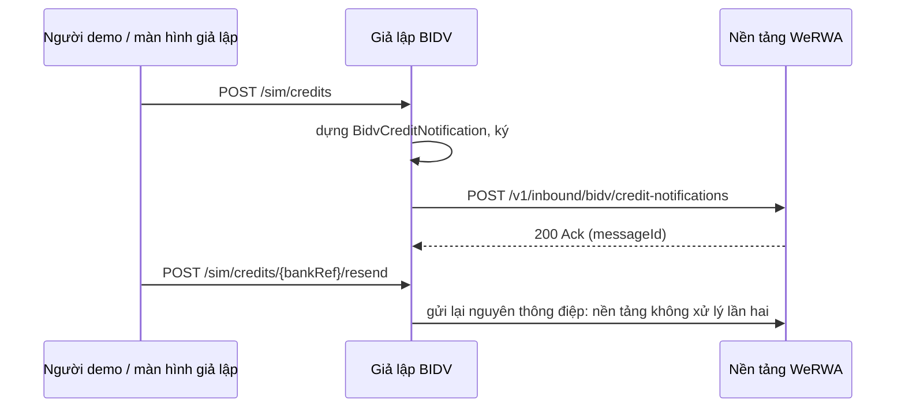

# Giả lập BIDV Open API

Chỉ dùng ở devnet (Q55). Tạo báo có theo tài khoản ảo, ký thông điệp như BIDV (Q49: ECDSA P-256, SHA-256 trên thân thô,
base64 trong `X-Bank-Signature`) rồi gọi webhook `POST /v1/inbound/bidv/credit-notifications` của nền tảng.



| API | Việc |
|---|---|
| `POST /sim/credits` | `{virtualAccount, amountMinor, currency, payerName, valueDate?, bankRef?, remittanceInfo?}`; trả thông điệp đã gửi và phản hồi của nền tảng |
| `POST /sim/credits/{bankRef}/resend` | Gửi lại nguyên thông điệp (US-5.02-AC3) |
| `GET /sim/credits` | Các báo có đã gửi |

| Biến môi trường | Ý nghĩa |
|---|---|
| `WERWA_PLATFORM_URL` | Địa chỉ nền tảng (ingress) |
| `BIDV_SIM_PRIVATE_KEY` | Khóa riêng EC P-256, PKCS#8 base64 hoặc PEM. Khóa công khai tương ứng đặt ở `WERWA_INTEGRATION_BIDV_PUBLICKEY` của nền tảng |
| `BIDV_SIM_PORT`, `BIDV_SIM_ADDRESS` | Mặc định `127.0.0.1:8090` |

Không có xác thực: chỉ chạy trong mạng devnet. Lệnh chi, sao kê làm ở B10.

```bash
mvn -f bidv-simulator/pom.xml spring-boot:run
```
