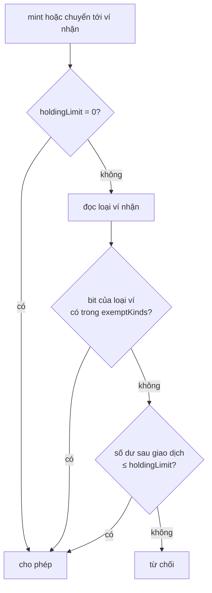

# ADR-0017 — Ví được miễn hạn mức nắm giữ: hỗ trợ cả ví omnibus của lưu ký và ví của WeRWA, chọn bằng cấu hình

- **Trạng thái:** Đề xuất
- **Ngày:** 2026-10-20
- **Người đề xuất:** Claude (phiên contracts), theo yêu cầu của Tommy Nguyen: "thiết kế cho cả 2 và chọn cấu hình sau"
- **Người duyệt:** SA

## Bối cảnh

`HoldingLimitModule` (docs/design/04-hop-dong-thong-minh.md, mục Module tuân thủ) miễn kiểm hạn mức cho ví omnibus. Hạn mức theo chủ sở hữu thật được kiểm ngoài chuỗi (giả định G7). Đặc tả chưa nói hợp đồng nhận biết ví omnibus bằng cách nào (câu hỏi C2).

Theo nghiệp vụ, ví omnibus là ví của ngân hàng lưu ký: lưu ký đứng tên, KYC nhìn xuyên, nhận coupon thay khách (docs/business/01-cau-truc-cac-ben.md; chức năng 1.05, Đ1). Tommy yêu cầu thiết kế thêm phương án ví omnibus do WeRWA nắm giữ, và chọn phương án bằng cấu hình về sau.

Hai phương án khác nhau ở bên giữ khóa:

| | (a) Ví omnibus của lưu ký | (b) Ví omnibus của WeRWA |
|---|---|---|
| Bên đứng tên và giữ khóa | Ngân hàng lưu ký | Holco, cho nhà đầu tư không tự giữ ví |
| KYC nhìn xuyên, chia coupon | Lưu ký | WeRWA, ngoài chuỗi |
| Hợp với nghiệp vụ hiện tại | Có (1.05, ADR-07) | Không: trái "Holco không giữ khóa ví nhà đầu tư" (ADR-07, CLAUDE.md) và quy tắc tách vai |

## Phương án đã cân nhắc

1. **Chỉ làm (a).** Đúng nghiệp vụ, nhưng muốn có (b) về sau thì phải sửa và triển khai lại module của mọi series đang lưu hành.
2. **Thay (a) bằng (b).** Đụng quyết định đã khóa, phải đổi nghiệp vụ trước khi viết code.
3. **Hỗ trợ cả hai ở mức hợp đồng, bật bằng cấu hình theo series.** Module phân biệt loại ví. Mỗi series có mặt nạ loại ví được miễn. Mặc định chỉ bật (a). Bật (b) là việc cấu hình qua timelock, làm sau khi nghiệp vụ đổi.

## Quyết định

Chọn phương án 3.

**Loại ví.** `HoldingLimitModule` giữ loại của từng ví theo series:

```solidity
enum WalletKind { STANDARD, CUSTODIAN_OMNIBUS, PLATFORM_OMNIBUS }
```

- `STANDARD`: ví nhà đầu tư tự giữ khóa; luôn bị kiểm hạn mức.
- `CUSTODIAN_OMNIBUS`: phương án (a).
- `PLATFORM_OMNIBUS`: phương án (b).

**Cấu hình theo series.** Đặt khi triển khai series:

- `holdingLimit` (`uint64`; 0 = không giới hạn), như đặc tả.
- `exemptKinds` (`uint8`, mặt nạ bit theo `WalletKind`). Mặc định là `1 << CUSTODIAN_OMNIBUS`. Bit `STANDARD` không bao giờ được bật; hợp đồng từ chối.

**Luật.** Ví nhận được miễn khi loại của ví có bit tương ứng trong `exemptKinds`. Ví không được miễn phải thỏa: số dư sau giao dịch ≤ `holdingLimit`. Luật áp cho cả mint và chuyển nhượng.



**Ai đổi gì.**

| Thao tác | Hàm | Bên ký |
|---|---|---|
| Đặt `holdingLimit`, `exemptKinds`, danh sách ví omnibus ban đầu | qua `SeriesFactory` khi triển khai | UBND, VSDC, Holco · 3/3 |
| Thêm, đổi loại hoặc bỏ một ví omnibus | `setWalletKind(wallet, kind)` gọi qua compliance của series | Timelock (3/3 lên lịch) |
| Bật hoặc tắt loại được miễn | `setExemptKinds(mask)` gọi qua compliance của series | Timelock (3/3 lên lịch) |

Hàm đổi cấu hình chỉ nhận lời gọi từ compliance đã gắn module. Compliance thuộc timelock, theo cơ chế module của T-REX. Mỗi lần đổi phát sự kiện `WalletKindSet(compliance, wallet, kind)` hoặc `ExemptKindsSet(compliance, mask)`.

**Chọn cấu hình.**

- Bản XD và mọi series đến khi có quyết định khác: `exemptKinds = CUSTODIAN_OMNIBUS`.
- Chỉ bật `PLATFORM_OMNIBUS` cho một series sau khi Tommy đổi nghiệp vụ, gồm bên giữ khóa, KYC nhìn xuyên và chia coupon. Khóa của ví WeRWA phải nằm trong HSM theo ADR-06.

**Không đổi.**

- `InvestorClassModule` không miễn cho ví omnibus. Ví omnibus của cả hai loại vẫn phải có claim INVESTOR_CLASS hợp lệ, với mã loại nằm trong danh sách của series.
- Việc kiểm nhà đầu tư thật đứng sau ví omnibus làm ngoài chuỗi.

## Hệ quả

- **Trang thiết kế phải sửa** (sau khi duyệt, trong PR này hoặc PR kế tiếp):
  - `04-hop-dong-thong-minh.md`, dòng `HoldingLimitModule`: thêm `exemptKinds` và loại ví.
  - `docs/open-questions.md` G7: ghi theo ADR này.
  - `02-mo-hinh-du-lieu.md`, `wallet.wallet_type`: chỉ thêm `PLATFORM_OMNIBUS` khi bật (b). Bản XD giữ `SELF`, `OMNIBUS`; `OMNIBUS` ứng với `CUSTODIAN_OMNIBUS`.
- **Ảnh hưởng tới `api/`:**
  - ABI của `HoldingLimitModule` có thêm hai hàm cấu hình và hai sự kiện.
  - Không đổi OpenAPI hay sự kiện nghiệp vụ ở bản XD.
- **Dữ liệu và hợp đồng đã triển khai:** chưa có series nào triển khai. Bật (b) về sau chỉ cần cấu hình, không phải triển khai lại.
- **Rủi ro còn lại:** phương án (b) có sẵn trong mã nhưng tắt. Bật nó mà chưa đổi nghiệp vụ là trái ADR-07. Vì vậy bật phải qua timelock 3/3, có báo trước, và các bên đều thấy.
