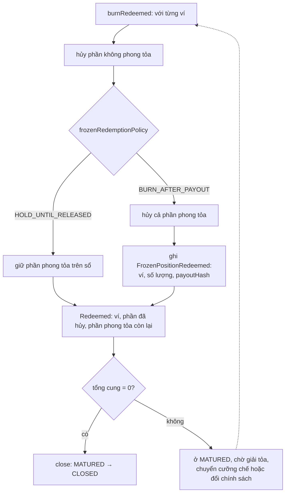

# ADR-0018 — Vị thế đang phong tỏa khi đáo hạn: hai chính sách, chọn bằng cấu hình khi vận hành

- **Trạng thái:** Đề xuất
- **Ngày:** 2026-10-20
- **Người đề xuất:** Claude (phiên contracts), theo yêu cầu của Tommy Nguyen: "cấu hình để lựa chọn 2 phương án khi vận hành"
- **Người duyệt:** SA

## Bối cảnh

Khi đáo hạn, `burnRedeemed` hủy toàn bộ số dư không bị phong tỏa của từng ví (US-2.10-AC3, giả định G6). Sau đó `close()` chỉ chạy khi tổng cung bằng 0 (docs/design/04-hop-dong-thong-minh.md).

Nếu còn vị thế đang phong tỏa theo lệnh của cơ quan có thẩm quyền (4.02), tổng cung không về 0. Series nằm ở MATURED tới khi có lệnh giải tỏa hoặc chuyển cưỡng chế (câu hỏi C12).

Có hai cách xử lý:

| | (a) Giữ tới khi giải tỏa | (b) Hủy sau khi IPA xác nhận chi gốc |
|---|---|---|
| Trái phiếu bị phong tỏa | Vẫn nằm trên sổ, vẫn phong tỏa | Bị hủy cùng phần còn lại |
| Tiền gốc của vị thế phong tỏa | Giữ tại IPA | Giữ tại IPA; quyền theo lệnh phong tỏa chuyển sang khoản tiền này, ghi lại trên chuỗi |
| Đóng series | Chờ lệnh giải tỏa hoặc chuyển cưỡng chế | Đóng được ngay sau khi hủy hết |
| Khớp với | Đặc tả hiện tại (G6) | Đóng series sạch sau đáo hạn (US-2.10) |

## Phương án đã cân nhắc

1. **Chỉ (a)** — đúng đặc tả. Series có thể treo ở MATURED lâu, tùy cơ quan ra lệnh.
2. **Chỉ (b)** — đóng series sạch, nhưng hủy trái phiếu đang bị phong tỏa có thể phải được cơ quan ra lệnh chấp nhận. Việc này cần pháp lý xác nhận.
3. **Có cả hai, chọn bằng cấu hình theo series khi vận hành** — mặc định (a); chuyển sang (b) khi có căn cứ.

## Quyết định

Chọn phương án 3.

**Cấu hình.** `SeriesController` có tham số `frozenRedemptionPolicy` với hai giá trị:

```solidity
enum FrozenRedemptionPolicy { HOLD_UNTIL_RELEASED, BURN_AFTER_PAYOUT }
```

- `HOLD_UNTIL_RELEASED` là phương án (a). Đây là giá trị mặc định khi triển khai, giữ đúng G6.
- `BURN_AFTER_PAYOUT` là phương án (b).

**Ai đổi, khi nào.**

| Thao tác | Hàm | Bên ký | Trạng thái cho phép |
|---|---|---|---|
| Đổi chính sách | `setFrozenRedemptionPolicy(policy, basisHash)` | GOVERNANCE · 3/3 | mọi trạng thái trừ CLOSED, CANCELLED |

- `basisHash` là mã băm căn cứ: quyết định của các bên, hoặc ý kiến của cơ quan ra lệnh phong tỏa.
- Mỗi lần đổi phát sự kiện `FrozenRedemptionPolicySet(policy, basisHash)`.

**Luật của `burnRedeemed(holders)`** (OPERATOR, chỉ ở MATURED, sau khi đã gọi `mature` với xác nhận chi gốc của IPA):



- Với `BURN_AFTER_PAYOUT`, hợp đồng phát `FrozenPositionRedeemed(wallet, quantity, payoutHash)` cho từng vị thế phong tỏa bị hủy. `payoutHash` là mã băm xác nhận chi gốc của IPA đã ghi khi gọi `mature`. Đây là căn cứ để IPA giữ khoản gốc tương ứng cho cơ quan ra lệnh.
- Với `HOLD_UNTIL_RELEASED`, phần phong tỏa ở lại trên sổ. Ở MATURED vẫn gọi được `unfreeze` và `forcedTransfer` (đặc tả đã cho phép), rồi gọi lại `burnRedeemed` cho ví đó.
- Đổi chính sách khi series đang ở MATURED rồi gọi lại `burnRedeemed` thì áp chính sách mới cho phần còn lại.

**Không đổi.**

- `burnRedeemed` vẫn chỉ chạy ở MATURED, vẫn bị chặn khi series tạm dừng (C6).
- Ngoài chuỗi, bất kể chính sách, IPA giữ phần gốc của vị thế phong tỏa (máy Kỳ trả nợ, cạnh 5; `distribution_line.withheld_reason = FROZEN`).

## Hệ quả

- **Trang thiết kế phải sửa** sau khi duyệt:
  - `04-hop-dong-thong-minh.md`: dòng `burnRedeemed`; thêm hàm `setFrozenRedemptionPolicy` và hai sự kiện.
  - `docs/open-questions.md`: G6 và C12 ghi theo ADR này.
- **Ảnh hưởng tới `api/`:**
  - ABI của `SeriesController` có thêm một hàm, một enum, hai sự kiện; sự kiện `Redeemed` có thêm trường phần phong tỏa còn lại.
  - Có thể cần một sự kiện nghiệp vụ mới để báo IPA giữ gốc cho vị thế phong tỏa. Việc này chờ luồng backend quyết.
- **Dữ liệu và hợp đồng đã triển khai:** chưa có series nào. Thêm biến lưu trữ trước `__gap` theo quy tắc nâng cấp.
- **Câu hỏi cho pháp lý** (không chặn bản XD): hủy trái phiếu đang bị phong tỏa sau khi gốc đã chi vào IPA có cần cơ quan ra lệnh đồng ý trước không. Nếu cần, `basisHash` của lần đổi chính sách phải là văn bản đồng ý đó.
