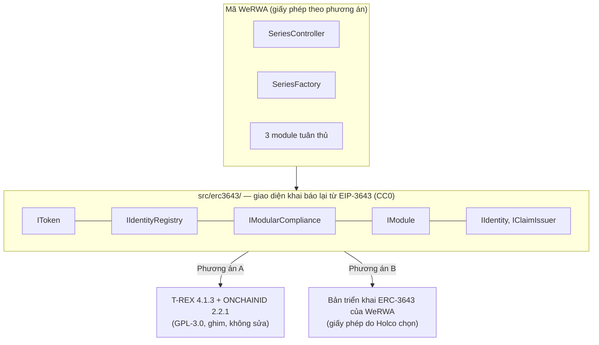

# ADR-0019 — Giấy phép GPL-3.0 của T-REX: hai phương án triển khai ERC-3643, chọn sau khi có ý kiến pháp lý

- **Trạng thái:** Đã duyệt (Tommy Nguyen, 20/10/2026) — duyệt phần "Quyết định đề xuất"
- **Ngày:** 2026-10-20
- **Người đề xuất:** Claude (phiên contracts), theo yêu cầu của Tommy Nguyen: "Pháp lý. thiết kế 2 option"
- **Người duyệt:** SA

## Bối cảnh

Hợp đồng token, các sổ đăng ký và modular compliance dùng bản tham chiếu T-REX 4.1.3 của ERC-3643. ONCHAINID 2.2.1 được dùng cho định danh và claim. **Cả hai đều theo GPL-3.0.**

Chỉ OpenZeppelin dùng giấy phép MIT. Văn bản chuẩn EIP-3643 dùng CC0, nên ai cũng được khai báo lại các giao diện của chuẩn. Pháp lý cần xác nhận điểm này, cùng với giấy phép của văn bản ERC-734/735.

Câu hỏi đang chờ pháp lý (docs/design/04-hop-dong-thong-minh.md, mục "Còn mở"):
1. Triển khai hợp đồng lên node của BIDV và VSDC có tính là chuyển giao bản sao theo GPL không.
2. Holco có cần giữ kín mã hợp đồng mở rộng của WeRWA không.

Hiện mã WeRWA phụ thuộc T-REX và ONCHAINID ở ba chỗ:

| Chỗ phụ thuộc | Tệp | Loại |
|---|---|---|
| Giao diện `IToken`, `IIdentityRegistry`, `ITrustedIssuersRegistry`, `IModularCompliance`, `IIdentity`, `IClaimIssuer` | `SeriesController`, ba module, `SeriesFactory` | import từ mã GPL |
| `AbstractModule` (lớp cha của ba module) | `WeRWAModuleBase` | kế thừa mã GPL |
| `TokenProxy`, `ModularComplianceProxy` | `SeriesFactory` | tạo hợp đồng từ mã GPL |

Vì kế thừa `AbstractModule` và nhúng mã proxy của T-REX, phần WeRWA hiện là tác phẩm phái sinh của T-REX.

## Phương án

### Bước chung, làm trước, dùng cho cả hai phương án

Tách mã WeRWA khỏi mã T-REX:

1. Thêm `src/erc3643/` gồm các giao diện khai báo lại từ văn bản EIP-3643 và ERC-734/735 (CC0).
2. Mã WeRWA chỉ import từ thư mục này, không import `@trex/...` hay `@onchain-id/...`.
3. `WeRWAModuleBase` tự cài phần gắn/gỡ compliance (khoảng 30 dòng), không kế thừa `AbstractModule`.
4. Factory nhận địa chỉ của các "bộ tạo" token và compliance qua cấu hình, không nhúng `TokenProxy` hay `ModularComplianceProxy`.
5. Bộ kiểm thử tham số hóa theo bản triển khai: cùng một bộ test và bất biến I1–I8 chạy với từng bản.

Sau bước này, mã WeRWA không còn là tác phẩm phái sinh của T-REX. Phương án A hay B chỉ còn khác nhau ở **bản triển khai được triển khai lên chuỗi**.

### Phương án A — Giữ T-REX và ONCHAINID (GPL-3.0)

- Triển khai bản tham chiếu đã ghim, như hiện nay.
- Nếu pháp lý kết luận việc triển khai lên node BIDV, VSDC hoặc việc giao mã cho bên khác là chuyển giao: cung cấp mã nguồn phần hợp đồng theo GPL-3.0 cho các bên nhận. Phần này gồm T-REX, ONCHAINID và phần WeRWA chạy cùng.
- Ứng dụng (Java, React), cơ sở dữ liệu và phần mềm node không bị ảnh hưởng. Chúng là chương trình riêng, giao tiếp qua JSON-RPC.
- **Ưu:** mã chuẩn đã được cộng đồng dùng và kiểm toán; không tăng phạm vi kiểm toán.
- **Nhược:** nếu bị coi là chuyển giao, mã hợp đồng phải công khai cho bên nhận. Việc này vẫn phù hợp yêu cầu minh bạch của sổ nợ công.

### Phương án B — Bản triển khai ERC-3643 của WeRWA

- Holco tự viết token, sổ định danh, lưu trữ sổ định danh, chủ đề claim, bên cấp claim tin cậy, modular compliance, định danh và bên cấp claim.
- Bản tự viết cài đúng các giao diện ở `src/erc3643/`.
- Viết từ văn bản chuẩn, không chép mã T-REX hay ONCHAINID. Có quy trình viết sạch: người viết không đọc mã nguồn GPL trong lúc viết.
- Chỉ cài phần WeRWA dùng:
  - token: mint, burn, phong tỏa một phần, chuyển cưỡng chế, tạm dừng, decimals 0;
  - sổ định danh: `isVerified` theo claim của bên cấp tin cậy;
  - compliance theo module.
- **Ưu:** Holco tự chọn giấy phép và giữ kín mã được.
- **Nhược:** thêm khoảng 2–3 sprint cho kỹ sư hợp đồng; phạm vi kiểm toán gần gấp đôi; tự chịu trách nhiệm tương thích ví và công cụ của hệ sinh thái ERC-3643.

### So sánh

| | A · T-REX | B · Tự viết |
|---|---|---|
| Giấy phép phần hợp đồng | GPL-3.0 | Holco chọn |
| Công sức thêm | Không | Khoảng 2–3 sprint cho kỹ sư hợp đồng |
| Phạm vi kiểm toán (03/05 – 04/06/2027) | Phần WeRWA | Phần WeRWA và bản ERC-3643 tự viết |
| Tương thích hệ sinh thái ERC-3643 | Bản tham chiếu | Theo giao diện chuẩn; tự kiểm |
| Đổi khi đã có series lưu hành | — | Chỉ cho series mới; series cũ giữ bản đang chạy |

## Quyết định đề xuất

- **Làm ngay** bước chung (tách giao diện). Bước này không đổi hành vi, giữ được cả hai phương án và không chặn bản XD.
- **Bản XD chạy phương án A.**
- **Chọn A hay B khi có ý kiến pháp lý**, muộn nhất trước mốc chốt mã hợp đồng 30/04/2027.
  - Nếu chọn B, phải bắt đầu viết trước sprint Đ1 thứ hai, tức trước tháng 3/2027, để kịp kiểm toán.

## Hệ quả

- **Trang thiết kế phải sửa khi chọn:** `04-hop-dong-thong-minh.md`, cột "Nguồn" của bảng hợp đồng và mục "Còn mở"; `01-quyet-dinh-cong-nghe.md`, ADR-03.
- **Ảnh hưởng tới `api/`:** với phương án A, ABI không đổi. Với phương án B, ABI của token và sổ định danh giữ chữ ký hàm và sự kiện của chuẩn; backend sinh lại lớp web3j, giao diện không đổi.
- **Mã WeRWA:** bước chung là một PR `refactor/contracts/...` không đổi hành vi; bộ test và bất biến hiện có phải qua nguyên vẹn.
- **Giấy phép của tệp WeRWA:** đang ghi `GPL-3.0-or-later` (C8).
  - Chọn A: giữ nguyên.
  - Chọn B: đổi SPDX của các tệp WeRWA và bản tự viết theo quyết định của Holco.
