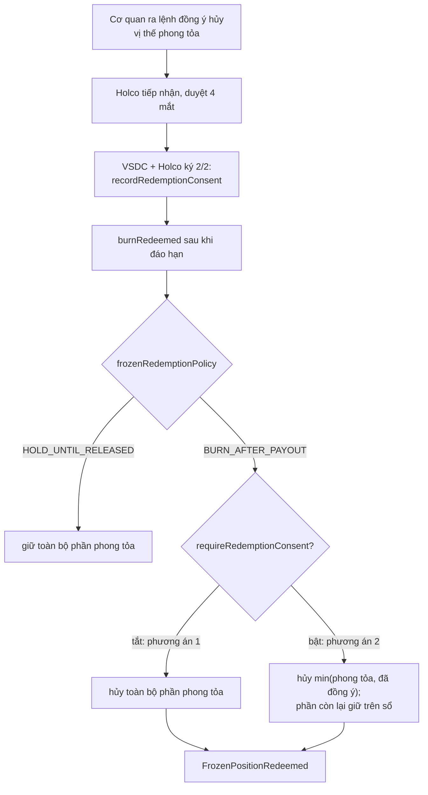

# ADR-0020 — Đồng ý của cơ quan ra lệnh trước khi hủy vị thế phong tỏa: hai phương án, chọn bằng cấu hình

- **Trạng thái:** Đã duyệt (Tommy Nguyen, 20/10/2026) — duyệt phần "Quyết định đề xuất"
- **Ngày:** 2026-10-20
- **Người đề xuất:** Claude (phiên contracts), theo yêu cầu của Tommy Nguyen: "Pháp lý. thiết kế 2 option"
- **Người duyệt:** SA
- **Bổ sung cho:** ADR-0018

## Bối cảnh

ADR-0018 cho phép chính sách `BURN_AFTER_PAYOUT`: sau khi IPA xác nhận chi gốc, hủy cả trái phiếu đang bị phong tỏa. Câu hỏi còn mở cho pháp lý: hủy trái phiếu đang bị phong tỏa theo lệnh của cơ quan có thẩm quyền có cần cơ quan đó đồng ý trước không.

ADR-0018 chỉ ghi một `basisHash` chung khi GOVERNANCE đổi chính sách cho cả series. Nếu cần đồng ý, đồng ý đó phải gắn với **từng lệnh phong tỏa**. Một series có thể có nhiều lệnh, của nhiều cơ quan khác nhau.

## Phương án

### Phương án 1 — Không cần đồng ý riêng (hành vi của ADR-0018)

`BURN_AFTER_PAYOUT` hủy toàn bộ phần phong tỏa của mọi ví được đưa vào `burnRedeemed`. Căn cứ là `basisHash` chung lúc đổi chính sách. Mỗi vị thế bị hủy phát `FrozenPositionRedeemed`, để IPA giữ khoản gốc tương ứng.

### Phương án 2 — Cần đồng ý theo từng vị thế

Thêm hàm ghi đồng ý, đi cùng luồng lệnh phong tỏa 4.02: tiếp nhận, duyệt 4 mắt, rồi VSDC và Holco ký 2/2.

```solidity
function recordRedemptionConsent(address wallet, uint64 quantity, bytes32 orderHash, bytes32 consentHash)
    external; // ENFORCEMENT; trạng thái ACTIVE, DEFAULTED, MATURED
event RedemptionConsentRecorded(address indexed wallet, uint64 quantity, bytes32 orderHash, bytes32 consentHash);
```

- `orderHash`: mã băm lệnh phong tỏa đã ghi khi gọi `freeze`.
- `consentHash`: mã băm văn bản đồng ý của cơ quan ra lệnh.

Với `BURN_AFTER_PAYOUT`, mỗi ví chỉ bị hủy tối đa `min(phần đang phong tỏa, số lượng đã có đồng ý)`. Phần còn lại giữ trên sổ như `HOLD_UNTIL_RELEASED`.



### Chọn bằng cấu hình

| Tham số | Giá trị | Ai đổi | Trạng thái cho phép |
|---|---|---|---|
| `requireRedemptionConsent` (bool, theo series) | `true`: phương án 2; `false`: phương án 1 | GOVERNANCE · 3/3, kèm `basisHash` | mọi trạng thái trừ CLOSED, CANCELLED |

- Đổi tham số phát `RedemptionConsentRequirementSet(required, basisHash)`.
- **Mặc định `true`.** Khi chưa có ý kiến pháp lý, an toàn hơn là chưa hủy được vị thế phong tỏa nếu chưa có đồng ý. Khi pháp lý kết luận không cần, GOVERNANCE tắt tham số.

## So sánh

| | 1 · Không cần đồng ý | 2 · Đồng ý theo từng vị thế |
|---|---|---|
| Căn cứ trên chuỗi | Một `basisHash` cho cả series | `consentHash` cho từng vị thế, gắn `orderHash` |
| Bên ký | GOVERNANCE 3/3 | GOVERNANCE 3/3 đổi chính sách; ENFORCEMENT 2/2 ghi từng đồng ý |
| Đóng series | Ngay sau khi hủy hết | Chờ đủ đồng ý, hoặc giải tỏa, hoặc chuyển cưỡng chế |
| Thay đổi mã | Không | Thêm 1 hàm, 2 sự kiện, 2 biến lưu trữ (mapping đồng ý và cờ) trước `__gap` |

## Quyết định đề xuất

- Code cả hai phương án và chọn bằng `requireRedemptionConsent`, như cách làm của ADR-0017 và ADR-0018.
- Mặc định bật phương án 2 cho tới khi có ý kiến pháp lý.
- Code chỉ viết khi ADR này được duyệt. Dự kiến một PR nhỏ trên `SeriesController`, kèm kiểm thử và mở rộng bất biến I3, I6.

## Hệ quả

- **Trang thiết kế phải sửa:** `04-hop-dong-thong-minh.md`, thêm hàm, sự kiện và tham số ở nhóm "Tuân thủ".
- **Dữ liệu ngoài chuỗi:** `governance.enforcement_order.action` thêm giá trị `REDEMPTION_CONSENT` (`02-mo-hinh-du-lieu.md`); máy Phong tỏa thêm một nhánh đi lại các bước 1 đến 4 (`03-may-trang-thai.md`).
- **Ảnh hưởng tới `api/`:** ABI của `SeriesController` thêm một hàm, hai sự kiện; có thể thêm `action` mới cho `POST /v1/enforcement-orders` (PR API riêng, merge trước).
- **Hợp đồng đã triển khai:** chưa có. Hai biến mới thêm trước `__gap` (27 → 25) theo quy tắc nâng cấp.
