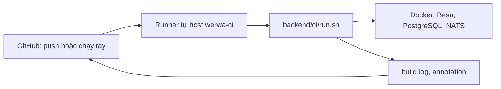

# infra/ci — runner GitHub Actions tự host

Phương án A (Tommy duyệt 31/10/2026): chạy CI backend trên VM của WeRWA thay cho máy GitHub, vì GitHub Actions đang bị khóa thanh toán và CI backend cần Docker cho Besu, PostgreSQL, NATS (Testcontainers). Nếu khóa thanh toán chặn cả runner tự host thì chuyển phương án B (bộ chạy độc lập, báo trạng thái commit qua API); kịch bản `backend/ci/run.sh` dùng lại được.

## VM

| Mục | Giá trị |
|---|---|
| Hệ điều hành | Ubuntu 24.04 LTS (x64 hoặc arm64) |
| Cấu hình | 8 vCPU, 16 GB RAM, 100 GB đĩa |
| Mạng ra | GitHub (`github.com`, `api.github.com`, `*.actions.githubusercontent.com`, `objects.githubusercontent.com`), Maven Central, Docker Hub, `download.docker.com`, `foundry.paradigm.xyz` và bản phát hành Foundry trên GitHub |
| Mạng vào | Không cần; runner tự gọi ra GitHub |
| Khóa | Không đặt khóa thật; kiểm thử chỉ dùng khóa sinh lúc chạy |

## Dựng

1. GitHub: Settings → Actions → Runners → New self-hosted runner, chép token (sống 1 giờ).
2. Trên VM: `sudo RUNNER_TOKEN=<token> infra/ci/runner-setup.sh`.
3. GitHub: Settings → Secrets and variables → Actions → Variables, tạo `WERWA_BACKEND_RUNNER` = `["self-hosted","linux","werwa-ci"]`.
4. Chạy thử: Actions → backend → Run workflow trên một nhánh, hoặc push một commit không có `[skip ci]`.

Bỏ biến `WERWA_BACKEND_RUNNER` thì workflow quay về `ubuntu-latest`.

## An toàn

- Repo private, runner gắn riêng repo này; không nhận PR từ fork.
- Runner chạy bằng người dùng `runner` (nhóm `docker`), không phải root. Người có quyền ghi repo chạy được lệnh trên VM, nên VM chỉ dùng cho CI, không chứa khóa hay dữ liệu thật.
- Token đăng ký chỉ truyền qua biến môi trường lúc dựng.

## Chạy tay không qua GitHub

Trên máy có Docker, JDK 21, Maven, Foundry 1.8.5, `jq`: `cd backend && ci/run.sh`. Kết quả ở `backend/build.log`.
